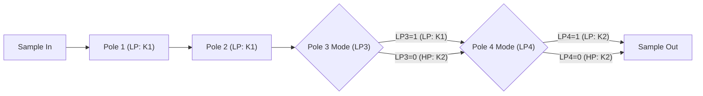

# Ensoniq ES5505 (OTIS) 与 ES5506 (OTTO) 芯片技术规范

> 基于原厂官方工程规格说明书：
> * **Ensoniq 5505 "OTIS" Specification**（18 页，包含波表插值、4 阶滤波网络、音量位移表）
> * **Ensoniq ES 5506 "OTTO" Specification Rev 2.3**（51 页，包含 32 通道架构、$\mu$-Law 映射表、硬件包络斜率引擎与级联时序）

---

## 1. 概述与芯片历史

**Ensoniq ES5505（研发代号 OTIS - Ensoniq Technology Integrating Synthesis）** 与其第二代演进版 **ES5506（研发代号 OTTO - Ensoniq Technology Translating Operator）** 是美国 Ensoniq 公司在 1980 年代末至 1990 年代初设计的专用大规模集成电路（VLSI）多声道波表音频合成芯片。

这两颗芯片凭借其高保真度的样条插值算法、32 个独立振荡器通道以及内置的级联数字滤波网络，被广泛应用于专业电子乐器（如 Ensoniq VFX, SD-1, SQ-1, TS-10, ASR-10, EPS-16+ 等）、PC 高级声卡（如 Gravis UltraSound, Ensoniq Soundscape）以及 Taito 的多款 32 位街机基板（如 Taito F3 Cybercore 系统）。

### 主要技术参数深度对比

| 特性 | ES5505 (OTIS) | ES5506 (OTTO) |
| :--- | :--- | :--- |
| **制造工艺** | 2.0 微米 双层金属 CMOS | 1.5 微米 双层金属 CMOS |
| **封装形式** | 48-pin DIP / 68-pin PLCC | 68-pin PLCC |
| **复音频道** | 32 个独立振荡器通道（可配对） | 32 个独立振荡器通道 |
| **相位累加器位宽** | 29-bit（20 位整数地址 + 9 位小数分量） | 32-bit（21 位整数地址 + 11 位小数分量） |
| **外部样本寻址** | 1M 16-bit 样本字空间（2MB 物理寻址） | 2M 16-bit 样本字空间（4MB 原生寻址，可扩展） |
| **内部计算精度** | 16-bit 线性精度运算 | 18-bit 滤波器前段精度，16-bit 滤波器输出 |
| **样本数据格式** | 16-bit 线性补码 PCM | 16-bit 线性补码 PCM / 8-bit $\mu$-law 压缩 |
| **滤波网络** | 4 阶级联单极点巴特沃斯低通/高通滤波器 | 4 阶级联单极点巴特沃斯低通/高通滤波器 |
| **串行输出接口** | 4 对立体声串行输出通道（8 物理声道） | 6 对立体声串行输出通道（12 物理声道） |
| **硬件音量控制** | 8-bit 左对齐寄存器（4 位尾数 + 4 位指数） | 16-bit 寄存器（8 位尾数 + 4 位指数） |
| **硬件包络斜率** | 无硬件包络（由宿主 CPU 或 DSP 软件插值） | 硬件 9 位包络计数器 + 独立音量/滤波斜率（RAMP） |
| **A/D 转换接口** | 8 选 1 模拟电位器输入 | 8 选 1 模拟电位器输入 |

---

## 2. 内部架构与发声模型

### 2.1 相位累加器与线性插值
芯片在每个采样周期按配置的活跃通道数（通过宿主写入活跃通道寄存器）依次轮询各振荡器：
1. **累加器步进**：
   * 正向播放（`DIR=0`）：
     $$\text{ACCUM} = (\text{ACCUM} + \text{FREQCOUNT}) \ \& \ \text{ACC\_MASK}$$
   * 反向播放（`DIR=1`）：
     $$\text{ACCUM} = (\text{ACCUM} - \text{FREQCOUNT}) \ \& \ \text{ACC\_MASK}$$
2. **两点线性插值（Linear Interpolation）**：
   芯片从外部存储器顺序读取相邻的两点样本 $S_1$ 和 $S_2$。
   * ES5505 取累加器低 9 位小数分量 $ACC_{fr}$：
     $$S_{\text{interpolated}} = S_1 + ACC_{fr} \times (S_2 - S_1) = \frac{S_1 \times (512 - ACC_{fr}) + S_2 \times ACC_{fr}}{512}$$
   * ES5506 取累加器低 11 位小数分量 $ACC_{fr}$：
     $$S_{\text{interpolated}} = S_1 + ACC_{fr} \times (S_2 - S_1) = \frac{S_1 \times (2048 - ACC_{fr}) + S_2 \times ACC_{fr}}{2048}$$

### 2.2 循环与播放模式（Looping Modes）
控制寄存器中的 `BLE`（Bidirectional Loop Enable）与 `LPE`（Loop Enable）字段决定循环逻辑：
* **模式 00（Non-looping / One-shot）**：
  当累加器超越 `END` 时，置位中断标志（若使能），并将控制寄存器置位 `STOP0` 停止发声。
* **模式 01（Uni-directional Forward Looping）**：
  当正向超越 `END` 时：
  $$\text{ACCUM} = \text{START} + (\text{ACCUM} - \text{END})$$
  保留超出部分的小数精度，实现无抖动循环。
* **模式 10（Trans-wave Looping，ES5506 特有）**：
  用于 Ensoniq 著名的 Transwave 波表调制算法。到达循环终点时，累加器跳回 `START`，同时硬件置位 `LEI`（Loop End Ignore）位并清除 `BLE`，使该通道自动无缝转为单次播放直至波形尾端。
* **模式 11（Bi-directional Ping-Pong Looping）**：
  到达终点时，硬件将超出量从终点反向扣除：
  $$\text{ACCUM} = \text{END} - (\text{ACCUM} - \text{END})$$
  并将方向位 `DIR` 取反；到达起点时同理反转回正向。

---

## 3. 四阶级联巴特沃斯数字滤波器（4-Pole Filter）

芯片内置 4 个级联的单极点滤波器单元：
* **Pole 1 & Pole 2**：固定配置为低通滤波器（Low Pass），滤波系数由 $K_1$ 决定。
* **Pole 3**：由 `LP3` 控制位决定是低通（使用 $K_1$）还是高通（使用 $K_2$）。
* **Pole 4**：由 `LP4` 控制位决定是低通（使用 $K_2$）还是高通（使用 $K_2$）。

### 官方差分方程
* **低通滤波器（Low Pass）**：
  $$Y_n = K \times (X_n - Y_{n-1}) + Y_{n-1}$$
* **高通滤波器（High Pass）**：
  $$Y_n = X_n - X_{n-1} + K \times Y_{n-1}$$
其中 $X_n$ 为当前级输入，$X_{n-1}$ 为前一采样输入，$Y_{n-1}$ 为该极点前一次输出，$K$ 为 16 位定点滤波系数。

---

## 4. 音量位移架构与硬件静音规范

### 4.1 ES5505 音量编码与位移规范（OTIS Specification 第 16 页）
ES5505 的左右音量寄存器（`LVOL` / `RVOL`）为 8 位左对齐格式：
* **前 4 位为尾数（Mantissa）**：硬件在 4 位尾数前追加前导 1，形成 5 位乘数 $1.MMMM$。
* **后 4 位为指数（Exponent）**：指定右移位数：
  * **Exponent 0x0**：**All 0's（硬件静音 Mute）**。
  * **Exponent 0x1**：向右位移 14 位。
  * **Exponent 0x2**：向右位移 13 位。
  * $\dots$
  * **Exponent 0xE**：向右位移 1 位。
  * **Exponent 0xF**：向右位移 0 位（满幅增益）。

> **模拟关键改进**：早期部分模拟代码因未对 Exponent 0 做全 0 静音特殊判断，导致在音量为 0 时仍计算输出微弱非零直流，现已严格对齐原厂规范修正为完全静音。

### 4.2 ES5506 音量与硬件斜率（OTTO Specification 第 11、37 页）
ES5506 提供 16 位音量寄存器，包含 8 位尾数与 4 位指数，并配备硬件包络发生器：
* **ECOUNT（9 位计数器）**：在每个采样周期自动减 1，直到递减为 0 停止。
* **斜率计算**：当 `ECOUNT != 0` 时，硬件在每个采样周期自动累加斜率寄存器：
  $$\text{LVOL} = \text{clamp}_{0}^{65535}(\text{LVOL} + \text{sign\_extend}(\text{LVRAMP}))$$
  $$\text{RVOL} = \text{clamp}_{0}^{65535}(\text{RVOL} + \text{sign\_extend}(\text{RVRAMP}))$$
  若未配置慢速滤波计数器，则同时以 `K1RAMP` 与 `K2RAMP` 平滑更新滤波系数 $K_1$ 与 $K_2$。

---

## 5. ES5506 $\mu$-Law 压缩数据解码

当通道控制寄存器的 `CMPD` 置 1 时，ES5506 启动硬件实时解压：
* 将外部 8 位波表数据映射为 16 位线性补码 PCM。
* 解码采用标准音频 $\mu$-Law 压缩算法的硬件查表实现（参见 OTTO 规范第 33 页）：
  * 指数字段（3 位）：决定基本段阶梯增益。
  * 尾数字段（4 位）：线性细分。
  * 符号位（1 位）：最高位为 1 表示正幅值，为 0 表示负幅值。

---

## 6. 街机扩展存储架构（Taito F3 exbank）

在 Taito F3 等大型街机基板上，游戏使用了高达 16MB ~ 32MB 的大容量样本 ROM，超越了原生寻址边界：
* Taito 采用外部逻辑电路实现了 **exbank** 分页机制，为主板 CPU 提供了按复音声道动态挂载 1MB~4MB 样本分页窗口的能力。
* `libvgm` 在实现中提供了完整的 4 个 Sample ROM 区域，支持每个区域的独立基地址映射、掩码以及区域别名（Region Aliasing）。
