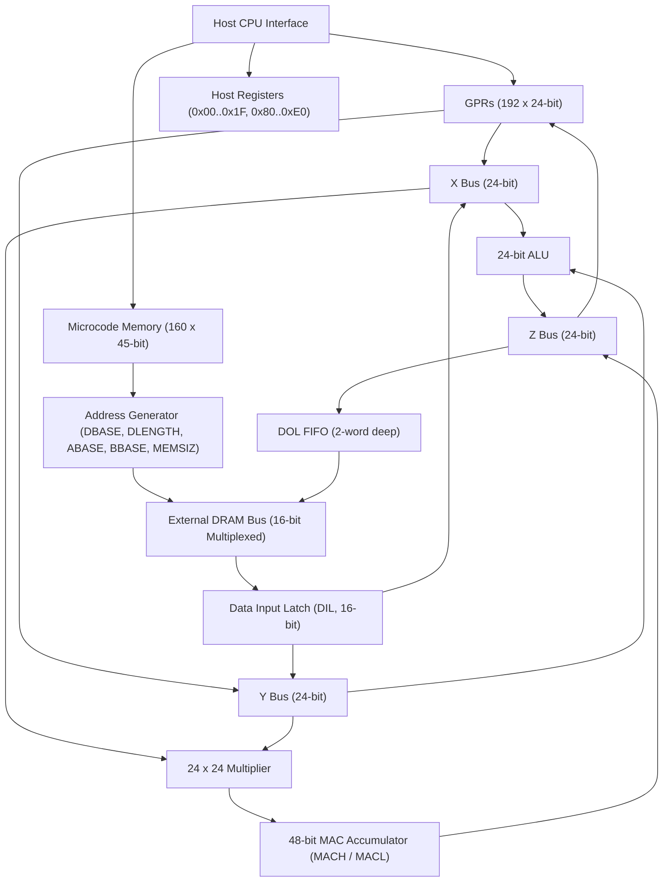

# Ensoniq ES5510 (ESP) 音频效果数字信号处理器技术规范

> 基于官方工程规格说明书：**ENSONIQ ESP Specification Rev. 2.4**（包含原厂数据表、寄存器定义、微码时序与主机接口规范）

---

## 1. 概述与主要特性

**Ensoniq ES5510（研发代号 ESP - Ensoniq Signal Processor）** 是 Ensoniq 专为音频信号处理研发的高性能超大规模集成电路（VLSI），采用 1.0 微米双层金属 CMOS 工艺制造。它针对音频频率范围（10 kHz ~ 50 kHz 典型采样率）进行深度优化，在每个音频采样周期内运行一次微程序。

ESP 的名义指令周期为 250 ns（4 MHz 指令率，在 12 MHz 主时钟下为 3 个时钟周期执行一条指令），在典型采样率下每个音频样本周期可执行 64 至 160 条微指令。

### 核心特性
* **封装形式**：48-Pin DIP 或 52-Pin PLCC。
* **独立地址发生器 ALU**：专门用于计算外部 DRAM 寻址，支持硬件环形延时线与查找表寻址。
* **4 通道可编程串行音频 I/O**：4 路立体声 16 位数字串行通道，支持 I2S 与 Sony 格式，可配置为主机（Master）或从机（Slave）模式。
* **片上数据与微程序 RAM**：集成 160 × 45-bit 微程序动态内存与 192 × 24-bit 通用数据寄存器（GPR）。
* **8 位复用主机 CPU 接口**：可直接挂接宿主微处理器（如 68000、6809、x86）。
* **外部采样率硬件同步**：通过外部 HALT 引脚精确锁定音频采样率。
* **外部 DRAM 延时线接口**：复用行列地址线，直接挂载外部 16-bit 宽 DRAM（如 64K×16、256K×16，支持 16 KB 至 1 MB 字空间）。
* **主机直接访问 ESP DRAM**：支持通过 DADR/DIL/DOL 寄存器在 HALT 模式下高速读写或硬件一键清零 DRAM。

---

## 2. 芯片内部架构与总线模型

### 2.1 三大 24 位内部数据总线
* **X 总线（24-bit）**：为 ALU 的 A 操作数以及乘法器的 C 操作数提供输入。
* **Y 总线（24-bit）**：为 ALU 的 B 操作数以及乘法器的 D 操作数提供输入。
* **Z 总线（24-bit）**：将 ALU 或乘法器的运算结果写回目标 GPR 或外部 DRAM 的 DOL 输出 FIFO。

### 2.2 寄存器空间分布
ESP 的操作数寻址空间为 8 位（0 ~ 255）：
* **0 ~ 191（0x00 ~ 0xBF）**：192 个 24 位通用寄存器（GPR）。
* **192 ~ 233（0xC0 ~ 0xE9）**：保留（未分配）。
* **234 ~ 255（0xEA ~ 0xFF）**：专用功能寄存器（SPR）与算术常量只读区。

#### 专用寄存器（SPR）全表
| 地址（十进制） | 地址（十六进制） | 位宽 | 寄存器名称 | 功能说明 |
| :--- | :--- | :--- | :--- | :--- |
| **234** | `0xEA` | 16 | **SER0R** | 串行口 0 右声道（读写） |
| **235** | `0xEB` | 16 | **SER0L** | 串行口 0 左声道（读写） |
| **236** | `0xEC` | 16 | **SER1R** | 串行口 1 右声道（读写） |
| **237** | `0xED` | 16 | **SER1L** | 串行口 1 左声道（读写） |
| **238** | `0xEE` | 16 | **SER2R** | 串行口 2 右声道（读写） |
| **239** | `0xEF` | 16 | **SER2L** | 串行口 2 左声道（读写） |
| **240** | `0xF0` | 16 | **SER3R** | 串行口 3 右声道（读写） |
| **241** | `0xF1` | 16 | **SER3L** | 串行口 3 左声道（读写） |
| **242** | `0xF2` | 24 | **MACL** | 乘加累加器低 24 位（Least Significant MAC） |
| **243** | `0xF3` | 24 | **MACH** | 乘加累加器高 24 位（Most Significant MAC） |
| **244 (R)** | `0xF4` | 16 | **DIL** | 外部 DRAM 数据输入锁存器（左对齐，低 8 位读出为 0） |
| **244 (W)** | `0xF4` | 20 | **MEMSIZ** | 系统 DRAM 容量掩码寄存器（直接影响 DBASE 步长） |
| **245** | `0xF5` | 20 | **DLENGTH** | 延时线缓冲区长度（Delay Length） |
| **246** | `0xF6` | 20 | **ABASE** | 查找表 A 基地址寄存器 |
| **247** | `0xF7` | 20 | **BBASE** | 查找表 B 基地址寄存器 |
| **248** | `0xF8` | 20 | **DBASE** | 延时线基地址计数器（每个 sample 周期递减，自动重载） |
| **249** | `0xF9` | 1 | **SIGREG** | 乘积移位控制（Bit 22: 1 = 左移 1 位，0 = 左移 2 位归一化） |
| **250** | `0xFA` | 5 | **CCR** | 条件码状态寄存器（N, C, V, LT, Z） |
| **251** | `0xFB` | 6 | **CMR** | 条件掩码寄存器（N, C, V, LT, Z, NOT） |
| **252** | `0xFC` | 24 | **$FFFFFF** | 常数 -1（MINUS 1） |
| **253** | `0xFD` | 24 | **$800000** | 常数 负满幅（Negative Full Scale / MIN） |
| **254** | `0xFE` | 24 | **$7FFFFF** | 常数 正满幅（Positive Full Scale / MAX） |
| **255** | `0xFF` | 24 | **$000000** | 常数 0（ZERO） |

---

## 3. 微指令格式（Microinstruction Word Format）

ESP 微指令字宽为 45 位（在内存中对齐为 48 位）：

| 位区间 | 位数 | 字段名称 | 功能描述 |
| :--- | :--- | :--- | :--- |
| **47 ~ 40** | 8 | **Mul Op D** | 乘法器 D 操作数 GPR/SPR 地址 |
| **39 ~ 32** | 8 | **Mul Op C** | 乘法器 C 操作数 GPR/SPR 地址 |
| **31 ~ 24** | 8 | **ALU Op B** | ALU B 操作数 GPR/SPR 地址 |
| **23 ~ 16** | 8 | **ALU Op A** | ALU A 操作数 GPR/SPR 地址（同时作为默认目标写入地址） |
| **15 ~ 12** | 4 | **ALU Opcode** | ALU 16 种算术/逻辑操作码 |
| **11 ~ 8** | 4 | **Operand Select** | 操作数总线映射（控制 A, B, C, D 来自 GPR 还是 DIL/DOL） |
| **7** | 1 | **Skip** | 可跳过标志（Skippable Flag，1 = 允许条件跳过执行） |
| **6** | 1 | **MAC** | 乘加使能（1 = 乘积累加到 MACHL，0 = 乘积直接覆盖累加器） |
| **5 ~ 3** | 3 | **RAM Cntrl** | 外部 DRAM 访问控制（延时线/表读写/FIFO倾倒） |
| **2 ~ 0** | 3 | **Unused** | 未使用（固定填 0） |

---

## 4. 运算核心与指令集体系

### 4.1 ALU 指令集全表
ESP 的 ALU 为 24 位宽，支持带饱和保护（Saturation Arithmetic）的补码运算：

| 助记符 | 操作码 | 操作数 | 运算表达式 | 标志位更新（N, C, V, LT, Z） |
| :--- | :--- | :--- | :--- | :--- |
| **ADD** | `0x0` | B, A | $A = A + B$（带正/负满幅饱和截断） | N, C, V(饱和), LT, Z 全部更新 |
| **SUB** | `0x1` | B, A | $A = A - B$（带正/负满幅饱和截断） | N, C, V(饱和), LT, Z 全部更新 |
| **ADDU** | `0x2` | B, A | $A = A + B$（无溢出保护，自然回绕） | N, C, V(溢出), LT, Z 全部更新 |
| **SUBU** | `0x3` | B, A | $A = A - B$（无溢出保护，自然回绕） | N, C, V(溢出), LT, Z 全部更新 |
| **CMP** | `0x4` | B, A | $A - B$（仅更新 CCR 标志位，不保存结果，不受 Skip 影响） | N, C, V, LT, Z 全部更新 |
| **AND** | `0x5` | B, A | $A = A \ \& \ B$（按位与） | N, Z 更新；C, V, LT 保持不变 |
| **OR** | `0x6` | B, A | $A = A \ \| \ B$（按位或） | N, Z 更新；C, V, LT 保持不变 |
| **XOR** | `0x7` | B, A | $A = A \ \oplus \ B$（按位异或，用于求反码） | N, Z 更新；C, V, LT 保持不变 |
| **ABS** | `0x8` | B, A | $A = \|B\|$（通过反码实现绝对值：$B < 0$ 时 $A = \sim B$） | N 清零，C 接收原符号位；V, LT, Z 保持不变 |
| **MOV** | `0x9` | B, A | $A = B$（基础数据传送，可用于 NOP） | 全部标志位保持不变 |
| **ASL2** | `0xA` | B, A | $A = B \times 4$（算术左移 2 位，带饱和截断） | N, V(饱和), Z 更新；C, LT 保持不变 |
| **ASL8** | `0xB` | B, A | $A = B \times 256$（算术左移 8 位，带饱和截断） | N, V(饱和), Z 更新；C, LT 保持不变 |
| **LS15** | `0xC` | B, A | $A = (B \ll 15) \ \& \ \$7FFFFF$（用于生成 8 位插值系数） | N 清零，C 接收原符号位移出的第 8 位；V, LT, Z 保持不变 |
| **DIFF** | `0xD` | B, A | $A = \$7FFFFF - B$（用于延时线交叉渐变 Crossfade） | N, C, V, LT, Z 全部更新（非饱和减法） |
| **ASR** | `0xE` | B, A | $A = B / 2$（算术右移 1 位，保留符号位） | N 更新，C 接收移出的最低位；V, LT, Z 保持不变 |
| **END** | `0xF` | 无 | 微程序结束；PC 归零，DBASE 递减，释放主机访问 | 全部标志位保持不变 |

### 4.2 条件执行与掩码机制（CCR 与 CMR）
* **CCR 寄存器（0xFA）** 映射于 24 位总线的最高字节（Bits 23 ~ 19）：
  * **Bit 23（N）**：负数结果（Negative）。
  * **Bit 22（C）**：进位（Carry / No-borrow）。
  * **Bit 21（V）**：溢出或饱和（Overflow / Saturation）。
  * **Bit 20（LT）**：带符号小于（Less Than），硬件计算公式：
    $$\text{LT} = (V \land \overline{N}) \lor (\overline{V} \land N)$$
  * **Bit 19（Z）**：零结果（Zero）。
* **CMR 掩码寄存器（0xFB）** 包含 5 个测试位与 1 个 NOT 取反位（Bits 23 ~ 18）：
  * **Bit 18（NOT）**：条件取反标志。
* **硬件跳过判定公式**：
  $$\text{SKIP} = \text{NOT}_m \oplus \big( (N \land N_m) \lor (Z \land Z_m) \lor (V \land V_m) \lor (C \land C_m) \lor (\text{LT} \land \text{LT}_m) \big)$$
  当判定为 TRUE 时，紧随其后带 `Skip=1` 的指令将作为 NOP 执行（不写入任何寄存器，累加器保持前值）。

#### 官方 14 种算术条件掩码编码（Negative Sense）
| 条件名称 | 助记符 | N | C | V | LT | Z | NOT | 掩码十六进制（高字节） | 24-bit 写入常量 |
| :--- | :--- | :---: | :---: | :---: | :---: | :---: | :---: | :---: | :---: |
| **Equal** | `EQ` | 0 | 0 | 0 | 0 | 1 | 1 | `0x0C` | `0x0C0000` |
| **Not Equal** | `NEQ` | 0 | 0 | 0 | 0 | 1 | 0 | `0x08` | `0x080000` |
| **Negative** | `NEG` | 1 | 0 | 0 | 0 | 0 | 1 | `0x84` | `0x840000` |
| **Positive** | `POS` | 1 | 0 | 0 | 0 | 0 | 0 | `0x80` | `0x800000` |
| **Overflow set** | `OV` | 0 | 0 | 1 | 0 | 0 | 1 | `0x24` | `0x240000` |
| **Overflow clear** | `OVC` | 0 | 0 | 1 | 0 | 0 | 0 | `0x20` | `0x200000` |
| **Lower than** | `LO` | 0 | 1 | 0 | 0 | 0 | 1 | `0x44` | `0x440000` |
| **Higher or same** | `HS` | 0 | 1 | 0 | 0 | 0 | 0 | `0x40` | `0x400000` |
| **Lower or same** | `LS` | 0 | 1 | 0 | 0 | 1 | 1 | `0x4C` | `0x4C0000` |
| **Higher than** | `HI` | 0 | 1 | 0 | 0 | 1 | 0 | `0x48` | `0x480000` |
| **Less than** | `LT` | 0 | 0 | 0 | 1 | 0 | 1 | `0x14` | `0x140000` |
| **Greater or equal** | `GTE` | 0 | 0 | 0 | 1 | 0 | 0 | `0x10` | `0x100000` |
| **Less or equal** | `LTE` | 0 | 0 | 0 | 1 | 1 | 1 | `0x1C` | `0x1C0000` |
| **Greater than** | `GT` | 0 | 0 | 0 | 1 | 1 | 0 | `0x18` | `0x180000` |
| **Always Skip** | `TRUE` | 0 | 0 | 0 | 0 | 0 | 1 | `0x04` | `0x040000` |
| **Never Skip** | `FALSE` | 0 | 0 | 0 | 0 | 0 | 0 | `0x00` | `0x000000` |

---

## 5. 乘法器与流水线模型

### 5.1 乘法器规格
* **输入操作数**：2 个 24 位带符号数（来自 X 总线与 Y 总线）。
* **硬件积与归一化**：$24 \times 24$ 硬件乘法在自然状态下产生带 2 个符号位的 48 位积。进入 48 位累加器前，由 `SIGREG` 的 Bit 22 控制左移：
  * **Bit 22 = 1**：左移 1 位（剥离多余符号位，保持 $\pm 1$ 范围归一化）。
  * **Bit 22 = 0**：左移 2 位（提供 $\pm 2$ 动态范围扩展）。
* **累加保护与饱和**：内部累加器额外提供 2 个保护位（Guard Bits，实际 50 位精度），允许瞬时求和超出 48 位；若最终输出仍溢出，则向 Z 总线输出正/负满幅饱和值（MACH: `$7FFFFF` / `$800000`，MACL: `$FFFFFF` / `$000000`）。

### 5.2 ALU 与乘法器流水线时序
* 乘法器的运算结果在 **下一个指令周期** 即可作为 ALU 的输入操作数。
* ALU 的运算结果需要 **经过 1 个周期的缓冲** 后才能被乘法器读取。

---

## 6. 外部 DRAM 寻址发生器与流水线

### 6.1 三种寻址模式
1. **延时线寻址（Delay Line Addressing）**：
   $$\text{ASUM} = \text{OFFSET\_GPR} + \text{DBASE}$$
   $$\text{ADDR} = \begin{cases} \text{ASUM}, & \text{ASUM} \le \text{DLENGTH} \\ (\text{ASUM} - \text{DLENGTH}) \pmod{\text{DLENGTH}}, & \text{ASUM} > \text{DLENGTH} \end{cases}$$
   最终送至 DRAM 的物理字地址由 MEMSIZ 进行掩码，并右移 `memshift` 位。
   在每个微程序执行到 `END` 指令时，硬件自动更新延时线基指针：
   $$\text{DBASE} = \text{DBASE} - \text{memincrement}$$
   当 $\text{DBASE} < 0$ 时，自动重载为 $\text{DLENGTH}$。
2. **查表寻址（Table Addressing）**：
   $$\text{ADDR} = (\text{OFFSET\_GPR} + \text{ABASE或BBASE}) \ \& \ \text{MEMMASK} \gg \text{memshift}$$
3. **I/O 空间寻址（I/O Space Addressing）**：
   直接将 GPR 中的绝对地址旁路输出到外部外设。

### 6.2 读写流水线
* **读操作**：在周期 $N$ 提交读地址，经过 $N-1$ 周期 DRAM 访问，数据在周期 $N-2$ 的后半段被锁存到 DIL（Data Input Latch）供后续微指令使用。
* **写操作**：ALU 或乘法器输出送至 2 级深的 DOL FIFO，当出现空闲写周期时，DOL FIFO 自动将数据弹入外部 DRAM。

---

## 7. 主机接口寄存器映射与握手

| 偏移（十六进制） | 位宽 | 寄存器名称 | 读/写说明 |
| :--- | :--- | :--- | :--- |
| **0x00** | 8 | GPR Latch [23:16] | 主机与 GPR 数据交互的高字节 |
| **0x01** | 8 | GPR Latch [15:8] | 主机与 GPR 数据交互的中字节 |
| **0x02** | 8 | GPR Latch [7:0] | 主机与 GPR 数据交互的低字节 |
| **0x03 ~ 0x08** | 48 | INSTR Latch | 48 位微指令锁存器（0x03: Mul D, 0x04: Mul C, 0x05: ALU B, 0x06: ALU A, 0x07: Opcode/Sel, 0x08: Skip/MAC/RAM） |
| **0x09 ~ 0x0B** | 24 | DIL Latch | DRAM 输入锁存器（0x09: MSB, 0x0A: LSB, 0x0B: 读出固定为 0x00） |
| **0x0C ~ 0x0E** | 24 | DOL Latch | DRAM 输出锁存器（0x0C: MSB, 0x0D: LSB, 0x0E: 读出固定为 0xFF） |
| **0x0F ~ 0x11** | 24 | DADR Latch | 外部 DRAM 访问物理地址（0x0F: 高位，写入 0x0F 立即触发 DRAM 读/写） |
| **0x12** | 3 | **Host Control** | Bit 2: Host Access OK/（低有效）；Bit 1: RAM Clear（写 1 清零 DRAM，自清零）；Bit 0: Refresh Disable |
| **0x14** | 2 | RAM Access Control | Bit 7: 1 = Read, 0 = Write；Bit 6: 1 = RAM, 0 = I/O Space |
| **0x16** | 8 | Program Counter | 测试用微程序计数器 |
| **0x18** | 8 | Host Serial Control | 串行口模式（Bit 7: Master/Slave; Bit 6: Sony/I2S; Bit 5..2: SER3..0 I/O 方向） |
| **0x1F** | 8 | Halt Enable / Frame Counter | 写：触发停止执行；读：帧计数器 |
| **0x80** | 8 | **Read Select** | 写入数据为寄存器地址（$00~$9F 读微码至锁存器，$00~$BF 读 GPR，$EA~$FF 读 SPR） |
| **0xA0** | 8 | **Write Select GPR** | 将 GPR Latch 写入选中的 GPR/SPR 地址 |
| **0xC0** | 8 | **Write Select INSTR** | 将 INSTR Latch 写入选中的微指令地址（$00~$9F） |
| **0xE0** | 8 | **Write Select Both** | 同时写入 GPR 与微指令 |

---

## 8. libvgm 模拟核优化要点

在对照 Rev 2.4 官方规范后，本项目对 `emu/cores/es5510.c` 进行了以下关键改进：
1. **CCR / CMR 寄存器高低位映射对齐**：
   官方规范明确指出 CCR/CMR 映射于 24 位总线的最高字节（Bits 23..18）。旧版 MAME 宏因笔误仅截断低 8 位，现优化为同时兼容高字节标准常量与低字节历史回退。
2. **算术指令标志位修正**：
   * `ABS`：修正为不修改 Z、V、LT 标志位，严格遵循官方规范第 14 页。
   * `ASL2` / `ASL8`：修正为不修改 C 标志位，仅更新 V（饱和）、N 与 Z。
   * `LS15`：修正 C 标志位为捕获在符号位被清零的原操作数第 8 位（`b >> 8 & 1`）。
3. **主机控制寄存器（0x12）读回**：
   返回实际维护的 `host_control`（包含 Host Access OK/ 等状态），替代原有固定返回 0。
4. **主机 DRAM 访问地址对齐**：
   主机通过 DADR 访问 DRAM 时，地址自动右移 `memshift` 位，与微程序内部延时线寻址完全统一。
